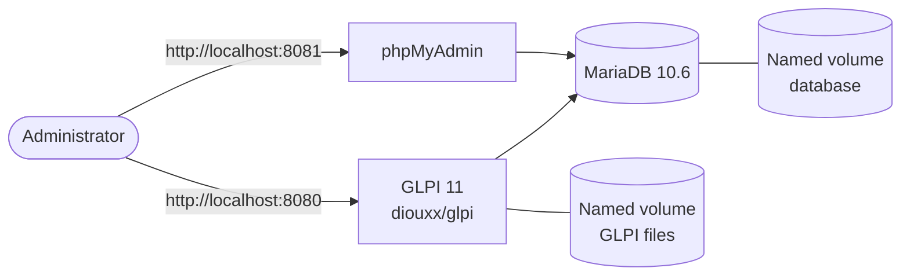
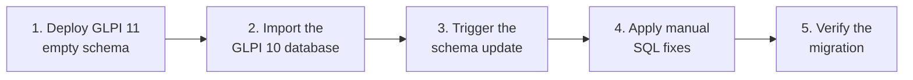

<div align="center">

# GLPI 10 → GLPI 11 Docker Migration

**A Dockerized GLPI 11 installation and the migration of an existing GLPI 10 database — entirely on Windows, with Docker Desktop and no Linux VM.**

Technical Internship Project · 2026

[**📸 Screenshots**](#screenshots) · [**🏗️ Architecture**](#architecture) · [**🇩🇪 Deutsch**](README.de.md)

[](https://www.docker.com/)
[](https://mariadb.org/)
[](https://glpi-project.org/)
[](https://www.phpmyadmin.net/)
[](https://learn.microsoft.com/powershell/)
[](LICENSE)

</div>

> **Confidentiality note.** For confidentiality reasons, no real company data (database dumps, screenshots showing real records) is included in this repository. Only the technical setup and the migration methodology are documented.

---

## Table of Contents

- [Overview](#overview)
- [Screenshots](#screenshots)
- [Features](#features)
- [Architecture](#architecture)
- [Tech Stack](#tech-stack)
- [Project Structure](#project-structure)
- [Getting Started](#getting-started)
- [Migration Process](#migration-process)
- [Author](#author)
- [License](#license)

---

## Overview

This project was carried out during a technical internship. The company was already running **GLPI 10** for IT asset and service management. The goal was to deploy a new **GLPI 11** environment with **Docker**, then migrate the existing database from version 10 to version 11 — entirely on Windows, using Docker Desktop and PowerShell / CMD, without any Linux virtual machine.

The work took about one month, covering the setup, the migration itself and the troubleshooting that came with it.

---

## Screenshots

<table width="100%">
  <tr>
    <td width="33%"></td>
    <td width="33%"></td>
    <td width="33%"></td>
  </tr>
</table>

👉 [View all screenshots](./screenshots)

---

## Features

### Infrastructure

- **Fully Dockerized** — three isolated, orchestrated containers
- **Persistent storage** — named volumes for both the database and the GLPI files
- **Web-based database management** — phpMyAdmin included for inspection and troubleshooting

### Migration

- **Version-to-version upgrade** — a GLPI 10.0.7 database migrated into a fresh GLPI 11 schema
- **Automated update detection** — GLPI's built-in upgrade wizard is triggered on first access
- **Manual schema fixes** — SQL adjustments applied where the automatic migration was incomplete

---

## Architecture



Three containers are orchestrated with Docker Compose: the GLPI application, the MariaDB database and phpMyAdmin. The database and the GLPI files live in named volumes, so they survive container restarts and re-creation.

---

## Tech Stack

| Technology | Usage |
|---|---|
| Docker Desktop | Container runtime on Windows |
| Docker Compose | Multi-container configuration |
| MariaDB 10.6 | Database engine |
| GLPI (`diouxx/glpi` image) | ITSM application |
| phpMyAdmin | Database administration |
| PowerShell / CMD | Command execution and migration commands |

---

## Project Structure

```
glpi-docker-migration/
│
├── docker-compose.yml     # GLPI, MariaDB and phpMyAdmin services
├── screenshots/           # Screenshots of the migrated instance
├── .gitignore
├── LICENSE
└── README.md
```

---

## Getting Started

### Prerequisites

- Docker Desktop (Windows)
- Basic familiarity with PowerShell / CMD

### Installation

1. Clone the repository:

   ```bash
   git clone https://github.com/El-Tousy/glpi-docker-migration.git
   cd glpi-docker-migration
   ```

2. Start the containers:

   ```powershell
   docker compose up -d
   ```

3. Open the services:
   - GLPI: [http://localhost:8080](http://localhost:8080)
   - phpMyAdmin: [http://localhost:8081](http://localhost:8081)

---

## Migration Process



1. **Deploy the new stack.** Start GLPI 11 from scratch so that the empty schema is created.
2. **Import the GLPI 10 database** into the new database container (the dump is not included in this repository):

   ```powershell
   docker exec -i glpi-db mysql -u glpi -p glpi < glpi_backup_10.0.7.sql
   ```

3. **Trigger the schema update.** Opening GLPI in the browser detects the version mismatch and starts the upgrade process automatically.
4. **Apply manual SQL fixes.** Some schema differences between GLPI 10 and 11 required manual adjustments, done from CMD.
5. **Verify the migration.** The database structure was checked in phpMyAdmin and the functionality was validated through the GLPI dashboard.

---

## Author

**El-Tousy** — Computer Science student, Morocco

[](https://github.com/El-Tousy)
[](mailto:leilaeltousy@gmail.com)

---

## License

Distributed under the MIT License. See [LICENSE](LICENSE) for details.

---

<div align="center">

⭐ If you find this project useful, consider leaving a star.

</div>
