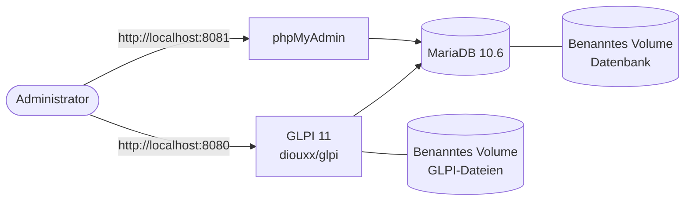
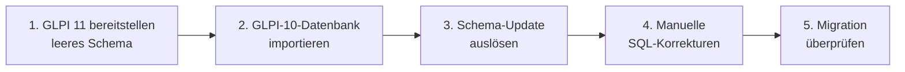

<div align="center">

# GLPI 10 → GLPI 11 Docker-Migration

**Eine Docker-basierte GLPI-11-Installation und die Migration einer bestehenden GLPI-10-Datenbank — vollständig unter Windows mit Docker Desktop und ohne Linux-VM.**

Projekt aus dem technischen Praktikum · 2026

[**📸 Screenshots**](#screenshots) · [**🏗️ Architektur**](#architektur) · [**🇬🇧 English**](README.en.md)

[](https://www.docker.com/)
[](https://mariadb.org/)
[](https://glpi-project.org/)
[](https://www.phpmyadmin.net/)
[](https://learn.microsoft.com/powershell/)
[](LICENSE)

</div>

> **Hinweis zur Vertraulichkeit.** Aus Gründen der Vertraulichkeit enthält dieses Repository keine echten Unternehmensdaten (Datenbank-Dumps, Screenshots mit echten Datensätzen). Dokumentiert werden ausschließlich der technische Aufbau und die Migrationsmethodik.

---

## Inhaltsverzeichnis

- [Überblick](#überblick)
- [Screenshots](#screenshots)
- [Funktionen](#funktionen)
- [Architektur](#architektur)
- [Tech-Stack](#tech-stack)
- [Projektstruktur](#projektstruktur)
- [Erste Schritte](#erste-schritte)
- [Migrationsablauf](#migrationsablauf)
- [Autor](#autor)
- [Lizenz](#lizenz)

---

## Überblick

Dieses Projekt wurde während eines technischen Praktikums durchgeführt. Das Unternehmen setzte bereits **GLPI 10** für die Verwaltung von IT-Assets und Services ein. Ziel war es, mit **Docker** eine neue **GLPI-11**-Umgebung bereitzustellen und anschließend die bestehende Datenbank von Version 10 auf Version 11 zu migrieren — vollständig unter Windows, mit Docker Desktop und PowerShell / CMD, ohne virtuelle Linux-Maschine.

Die Arbeit dauerte etwa einen Monat und umfasste die Einrichtung, die Migration selbst und die dabei anfallende Fehlersuche.

---

## Screenshots

<table width="100%">
  <tr>
    <td width="33%"></td>
    <td width="33%"></td>
    <td width="33%"></td>
  </tr>
</table>

👉 [Alle Screenshots ansehen](./screenshots)

---

## Funktionen

### Infrastruktur

- **Vollständig mit Docker betrieben** — drei isolierte, orchestrierte Container
- **Persistente Speicherung** — benannte Volumes sowohl für die Datenbank als auch für die GLPI-Dateien
- **Webbasierte Datenbankverwaltung** — phpMyAdmin für Inspektion und Fehlersuche enthalten

### Migration

- **Upgrade von Version zu Version** — eine GLPI-10.0.7-Datenbank wurde in ein frisches GLPI-11-Schema migriert
- **Automatische Update-Erkennung** — der integrierte Upgrade-Assistent von GLPI startet beim ersten Zugriff
- **Manuelle Schema-Korrekturen** — SQL-Anpassungen dort, wo die automatische Migration unvollständig war

---

## Architektur



Drei Container werden mit Docker Compose orchestriert: die GLPI-Anwendung, die MariaDB-Datenbank und phpMyAdmin. Die Datenbank und die GLPI-Dateien liegen in benannten Volumes und bleiben daher bei Neustarts und beim Neuerstellen der Container erhalten.

---

## Tech-Stack

| Technologie | Verwendung |
|---|---|
| Docker Desktop | Container-Laufzeitumgebung unter Windows |
| Docker Compose | Konfiguration mehrerer Container |
| MariaDB 10.6 | Datenbank-Engine |
| GLPI (Image `diouxx/glpi`) | ITSM-Anwendung |
| phpMyAdmin | Datenbankverwaltung |
| PowerShell / CMD | Ausführung von Befehlen und Migrationsbefehlen |

---

## Projektstruktur

```
glpi-docker-migration/
│
├── docker-compose.yml     # Dienste für GLPI, MariaDB und phpMyAdmin
├── screenshots/           # Screenshots der migrierten Instanz
├── .gitignore
├── LICENSE
└── README.md
```

---

## Erste Schritte

### Voraussetzungen

- Docker Desktop (Windows)
- Grundkenntnisse in PowerShell / CMD

### Installation

1. Repository klonen:

   ```bash
   git clone https://github.com/El-Tousy/glpi-docker-migration.git
   cd glpi-docker-migration
   ```

2. Container starten:

   ```powershell
   docker compose up -d
   ```

3. Dienste öffnen:
   - GLPI: [http://localhost:8080](http://localhost:8080)
   - phpMyAdmin: [http://localhost:8081](http://localhost:8081)

---

## Migrationsablauf



1. **Neuen Stack bereitstellen.** GLPI 11 frisch starten, damit das leere Schema angelegt wird.
2. **GLPI-10-Datenbank importieren** in den neuen Datenbank-Container (der Dump ist nicht Teil dieses Repositorys):

   ```powershell
   docker exec -i glpi-db mysql -u glpi -p glpi < glpi_backup_10.0.7.sql
   ```

3. **Schema-Update auslösen.** Beim Öffnen von GLPI im Browser wird die Versionsabweichung erkannt und der Upgrade-Prozess automatisch gestartet.
4. **Manuelle SQL-Korrekturen anwenden.** Einige Schemaunterschiede zwischen GLPI 10 und 11 erforderten manuelle Anpassungen, die über CMD vorgenommen wurden.
5. **Migration überprüfen.** Die Datenbankstruktur wurde in phpMyAdmin geprüft und die Funktionalität über das GLPI-Dashboard validiert.

---

## Autor

**El-Tousy** — Informatikstudentin, Marokko

[](https://github.com/El-Tousy)
[](mailto:leilaeltousy@gmail.com)

---

## Lizenz

Veröffentlicht unter der MIT-Lizenz. Siehe [LICENSE](LICENSE) für Details.

---

<div align="center">

⭐ Wenn dir dieses Projekt nützlich erscheint, hinterlasse gerne einen Stern.

</div>
